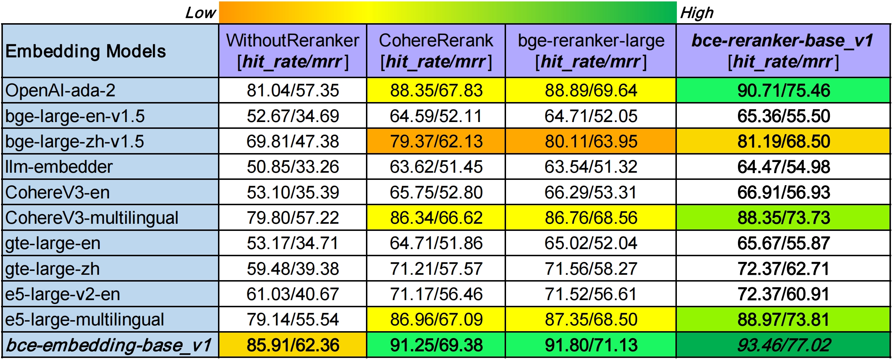

<!--
 * @Description: 
 * @Author: shenlei
 * @Modified: linhui
 * @Date: 2023-12-19 10:31:41
 * @LastEditTime: 2024-05-13 17:05:28
 * @LastEditors: shenlei
-->

<h1 align="center">BCEmbedding: Bilingual and Crosslingual Embedding for RAG</h1>

<div align="center">
    <a href="./LICENSE">
      
    </a>
        
    <a href="https://twitter.com/YDopensource">
      
    </a>
        
</div>
<br>

<p align="center">
  <a href="./README.md" target="_Self">English</a>
  |
  <strong style="background-color: green;">简体中文</strong>
</p>

<details open="open">
<summary>点击打开目录</summary>

- <a href="#-双语和跨语种优势" target="_Self">🌐 双语和跨语种优势</a>
- <a href="#-主要特点" target="_Self">💡 主要特点</a>
- <a href="#-最新更新" target="_Self">🚀 最新更新</a>
- <a href="#-模型列表" target="_Self">🍎 模型列表</a>
- <a href="#-使用指南" target="_Self">📖 使用指南</a>
  - <a href="#安装" target="_Self">安装</a>
  - <a href="#快速使用" target="_Self">快速使用(`transformers`, `sentence-transformers`)</a>
  - <a href="#embedding和reranker集成常用rag框架" target="_Self">Embedding和Reranker集成常用RAG框架 (`langchain`, `llama_index`)</a>
- <a href="#%EF%B8%8F-模型评测" target="_Self">⚙️ 模型评测</a>
  - <a href="#基于mteb的语义表征评测说明" target="_Self">基于MTEB的语义表征评测说明</a>
  - <a href="#基于llamaindex的rag评测说明" target="_Self">基于LlamaIndex的RAG评测说明</a>
- <a href="#-指标排行榜" target="_Self">📈 指标排行榜</a>
  - <a href="#基于mteb的语义表征评测指标" target="_Self">基于MTEB的语义表征评测指标</a>
  - <a href="#基于llamaindex的rag评测指标" target="_Self">基于LlamaIndex的RAG评测指标</a>
- <a href="#-有道bcembedding-api" target="_Self">🛠 有道BCEmbedding API</a>
- <a href="#-技术交流群" target="_Self">🧲 技术交流群</a>
- <a href="#%EF%B8%8F-引用说明" target="_Self">✏️ 引用说明</a>
- <a href="#-许可说明" target="_Self">🔐 许可说明</a>
- <a href="#-相关链接" target="_Self">🔗 相关链接</a>

</details>
<br>

`BCEmbedding`是由网易有道开发的中英双语和跨语种语义表征算法模型库，其中包含 `EmbeddingModel`和 `RerankerModel`两类基础模型。`EmbeddingModel`专门用于生成语义向量，在语义搜索和问答中起着关键作用，而 `RerankerModel`擅长优化语义搜索结果和语义相关顺序精排。

`BCEmbedding`作为有道的检索增强生成式应用（RAG）的基石，特别是在[QAnything](http://qanything.ai) [[github](https://github.com/netease-youdao/qanything)]中发挥着重要作用。QAnything作为一个网易有道开源项目，在有道许多产品中有很好的应用实践，比如[有道速读](https://read.youdao.com/#/home)和[有道翻译](https://fanyi.youdao.com/download-Mac?keyfrom=fanyiweb_navigation)。

`BCEmbedding`以其出色的双语和跨语种能力而著称，在语义检索中消除中英语言之间的差异，从而实现：

- **强大的双语和跨语种语义表征能力【<a href="#基于mteb的语义表征评测指标" target="_Self">基于MTEB的语义表征评测指标</a>】。**
- **基于LlamaIndex的RAG评测，表现SOTA【<a href="#基于llamaindex的rag评测指标" target="_Self">基于LlamaIndex的RAG评测指标</a>】。**



### 开源目的

给RAG社区一个可以直接拿来用，尽可能不需要用户finetune的中英双语和跨语种二阶段检索模型库，包含`EmbeddingModel`和`RerankerModel`。

- 只需一个模型：`EmbeddingModel`覆盖 **中英双语和中英跨语种** 检索任务，尤其是其跨语种能力。`RerankerModel`支持 **中英日韩** 四个语种及其跨语种。
- 只需一个模型： **覆盖常见业务落地领域**（针对众多常见rag场景已做优化），比如：教育、医疗、法律、金融、科研论文、客服(FAQ)、书籍、百科、通用QA等场景。用户不需要在上述特定领域finetune，直接可以用。
- 方便集成：`EmbeddingModel`和`RerankerModel`提供了LlamaIndex和LangChain **集成接口** ，用户可非常方便集成进现有产品中。
- 其他特性：
  - `RerankerModel`支持 **长passage（超过512 tokens，不超过32k tokens）rerank**；
  - `RerankerModel`可以给出有意义 **相关性分数** ，帮助 **过滤低质量召回**；
  - `EmbeddingModel` **不需要“精心设计”instruction** ，尽可能召回有用片段。

### 典型案例

- RAG应用项目：[QAnything](https://github.com/netease-youdao/qanything), [ragflow](https://github.com/infiniflow/ragflow), [HuixiangDou](https://github.com/InternLM/HuixiangDou), [ChatPDF](https://github.com/shibing624/ChatPDF).
- 高效推理引擎：[ChatLLM.cpp](https://github.com/foldl/chatllm.cpp), [Xinference](https://github.com/xorbitsai/inference), [mindnlp(支持华为显卡)](https://github.com/mindspore-lab/mindnlp/tree/master/llm/inference/bce).

## 🌐 双语和跨语种优势

现有的单个语义表征模型在双语和跨语种场景中常常表现不佳，特别是在中文、英文及其跨语种任务中。`BCEmbedding`充分利用有道翻译引擎的优势，实现只需一个模型就可以在单语、双语和跨语种场景中表现出卓越的性能。

`EmbeddingModel`支持***中文和英文***（之后会支持更多语种）；`RerankerModel`支持***中文，英文，日文和韩文***。

## 💡 主要特点

- **双语和跨语种能力**：基于有道翻译引擎的强大能力，`BCEmbedding`实现强大的中英双语和跨语种语义表征能力。
- **RAG适配**：面向RAG做针对性优化，可适配大多数相关任务，比如**翻译，摘要，问答**等。此外，针对 **问题理解（query understanding）** 也做了针对优化。详见 <a href="#基于llamaindex的rag评测指标" target="_Self">基于LlamaIndex的RAG评测指标</a>。
- **高效且精确的语义检索**：`EmbeddingModel`采用双编码器，可以在第一阶段实现高效的语义检索。`RerankerModel`采用交叉编码器，可以在第二阶段实现更高精度的语义顺序精排。
- **更好的领域泛化性**：为了在更多场景实现更好的效果，我们收集了多种多样的领域数据。
- **用户友好**：语义检索时不需要特殊指令前缀。也就是，你不需要为各种任务绞尽脑汁设计指令前缀。
- **有意义的重排序分数**：`RerankerModel`可以提供有意义的语义相关性分数（不仅仅是排序），可以用于过滤无意义文本片段，提高大模型生成效果。
- **产品化检验**：`BCEmbedding`已经被有道众多产品检验。

## 🚀 最新更新

- ***2024-02-04***: **BCEmbedding技术博客** - 包含算法设计和实操细节，<a href="https://zhuanlan.zhihu.com/p/681370855">为RAG而生-BCEmbedding技术报告</a>。
- ***2024-01-16***: **LangChain和LlamaIndex集成** - 详见<a href="#embedding和reranker集成常用rag框架" target="_Self">演示样例</a>。
- ***2024-01-03***: **模型发布** - [bce-embedding-base_v1](https://huggingface.co/maidalun1020/bce-embedding-base_v1)和[bce-reranker-base_v1](https://huggingface.co/maidalun1020/bce-reranker-base_v1)已发布.
- ***2024-01-03***: **RAG评测数据** [[CrosslingualMultiDomainsDataset](https://huggingface.co/datasets/maidalun1020/CrosslingualMultiDomainsDataset)] - 基于[LlamaIndex](https://github.com/run-llama/llama_index)的RAG评测数据已发布。
- ***2024-01-03***: **跨语种语义表征评测数据** [[详情](./BCEmbedding/evaluation/c_mteb/Retrieval.py)] - 基于[MTEB](https://github.com/embeddings-benchmark/mteb)的跨语种评测数据已发布.

## 🍎 模型列表

| 模型名称              |      模型类型      | 支持语种 | 参数量 |                                                                           开源权重                                                                           |
| :-------------------- | :----------------: | :------: | :----: | :-----------------------------------------------------------------------------------------------------------------------------------------------------------: |
| bce-embedding-base_v1 | `EmbeddingModel` |   中英   |  279M  | [Huggingface(推荐)](https://huggingface.co/maidalun1020/bce-embedding-base_v1), [国内通道](https://hf-mirror.com/maidalun1020/bce-embedding-base_v1), [ModelScope](https://www.modelscope.cn/models/maidalun/bce-embedding-base_v1/summary), [WiseModel](https://wisemodel.cn/models/Netease_Youdao/bce-embedding-base_v1) |
| bce-reranker-base_v1  | `RerankerModel` | 中英日韩 |  279M  |  [Huggingface(推荐)](https://huggingface.co/maidalun1020/bce-reranker-base_v1), [国内通道](https://hf-mirror.com/maidalun1020/bce-reranker-base_v1), [ModelScope](https://www.modelscope.cn/models/maidalun/bce-reranker-base_v1/summary), [WiseModel](https://wisemodel.cn/models/Netease_Youdao/bce-reranker-base_v1) |

## 📖 使用指南

### 安装

首先创建一个conda环境并激活

```bash
conda create --name bce python=3.10 -y
conda activate bce
```

然后最简化安装 `BCEmbedding`（为了避免自动安装的torch cuda版本和本地不兼容，建议先手动安装本地cuda版本兼容的[`torch`](https://pytorch.org/get-started/previous-versions/)）:

```bash
pip install BCEmbedding==0.1.5
```

也可以通过项目源码安装（**推荐**）:

```bash
git clone git@github.com:netease-youdao/BCEmbedding.git
cd BCEmbedding
pip install -v -e .
```

### 快速使用

#### 1. 基于 `BCEmbedding`

通过 `BCEmbedding`调用 `EmbeddingModel`。[pooler](./BCEmbedding/models/embedding.py#L24)默认是 `cls`。

```python
from BCEmbedding import EmbeddingModel

# list of sentences
sentences = ['sentence_0', 'sentence_1']

# init embedding model
model = EmbeddingModel(model_name_or_path="maidalun1020/bce-embedding-base_v1")

# extract embeddings
embeddings = model.encode(sentences)
```

通过 `BCEmbedding`调用 `RerankerModel`可以计算句子对的语义相关分数，也可以对候选检索结果进行排序。

```python
from BCEmbedding import RerankerModel

# your query and corresponding passages
query = 'input_query'
passages = ['passage_0', 'passage_1']

# construct sentence pairs
sentence_pairs = [[query, passage] for passage in passages]

# init reranker model
model = RerankerModel(model_name_or_path="maidalun1020/bce-reranker-base_v1")

# method 0: calculate scores of sentence pairs
scores = model.compute_score(sentence_pairs)

# method 1: rerank passages
rerank_results = model.rerank(query, passages)
```

注意：

- 在[`RerankerModel.rerank`](./BCEmbedding/models/reranker.py#L137)方法中，我们提供一个query和passage的拼接方法（在实际生产服务中使用），可适用于passage很长的情况。

#### 2. 基于 `transformers`

`EmbeddingModel`调用方法:

```python
from transformers import AutoModel, AutoTokenizer

# list of sentences
sentences = ['sentence_0', 'sentence_1']

# init model and tokenizer
tokenizer = AutoTokenizer.from_pretrained('maidalun1020/bce-embedding-base_v1')
model = AutoModel.from_pretrained('maidalun1020/bce-embedding-base_v1')

device = 'cuda'  # if no GPU, set "cpu"
model.to(device)

# get inputs
inputs = tokenizer(sentences, padding=True, truncation=True, max_length=512, return_tensors="pt")
inputs_on_device = {k: v.to(device) for k, v in inputs.items()}

# get embeddings
outputs = model(**inputs_on_device, return_dict=True)
embeddings = outputs.last_hidden_state[:, 0]  # cls pooler
embeddings = embeddings / embeddings.norm(dim=1, keepdim=True)  # normalize
```

`RerankerModel`调用方法:

```python
import torch
from transformers import AutoTokenizer, AutoModelForSequenceClassification

# init model and tokenizer
tokenizer = AutoTokenizer.from_pretrained('maidalun1020/bce-reranker-base_v1')
model = AutoModelForSequenceClassification.from_pretrained('maidalun1020/bce-reranker-base_v1')

device = 'cuda'  # if no GPU, set "cpu"
model.to(device)

# get inputs
inputs = tokenizer(sentence_pairs, padding=True, truncation=True, max_length=512, return_tensors="pt")
inputs_on_device = {k: v.to(device) for k, v in inputs.items()}

# calculate scores
scores = model(**inputs_on_device, return_dict=True).logits.view(-1,).float()
scores = torch.sigmoid(scores)
```

#### 3. 基于 `sentence_transformers`

`EmbeddingModel`调用方法：

```python
from sentence_transformers import SentenceTransformer

# list of sentences
sentences = ['sentence_0', 'sentence_1', ...]

# init embedding model
## sentence-transformers支持有更新，请注意先删除本地模型缓存："`SENTENCE_TRANSFORMERS_HOME`/maidalun1020_bce-embedding-base_v1"或“～/.cache/torch/sentence_transformers/maidalun1020_bce-embedding-base_v1”
model = SentenceTransformer("maidalun1020/bce-embedding-base_v1")

# extract embeddings
embeddings = model.encode(sentences, normalize_embeddings=True)
```

`RerankerModel`调用方法：

```python
from sentence_transformers import CrossEncoder

# init reranker model
model = CrossEncoder('maidalun1020/bce-reranker-base_v1', max_length=512)

# calculate scores of sentence pairs
scores = model.predict(sentence_pairs)
```

### Embedding和Reranker集成常用RAG框架

#### 1. 使用 `langchain`

为了继承`RerankerModel`精细优化的rerank逻辑，我们提供`BCERerank`方法，可直接集成到langchain demo中。

- 先安装langchain
```bash
pip install langchain==0.1.0
pip install langchain-community==0.0.9
pip install langchain-core==0.1.7
pip install langsmith==0.0.77
```

- 样例代码
```python
# 我们在`BCEmbedding`中提供langchain直接集成的接口。
from BCEmbedding.tools.langchain import BCERerank

from langchain.text_splitter import RecursiveCharacterTextSplitter
from langchain_community.document_loaders import PyPDFLoader
from langchain_community.vectorstores import FAISS

from langchain.embeddings import HuggingFaceEmbeddings
from langchain_community.vectorstores.utils import DistanceStrategy
from langchain.retrievers import ContextualCompressionRetriever


# init embedding model
embedding_model_name = 'maidalun1020/bce-embedding-base_v1'
embedding_model_kwargs = {'device': 'cuda:0'}
embedding_encode_kwargs = {'batch_size': 32, 'normalize_embeddings': True, 'show_progress_bar': False}

embed_model = HuggingFaceEmbeddings(
  model_name=embedding_model_name,
  model_kwargs=embedding_model_kwargs,
  encode_kwargs=embedding_encode_kwargs
)

reranker_args = {'model': 'maidalun1020/bce-reranker-base_v1', 'top_n': 5, 'device': 'cuda:1'}
reranker = BCERerank(**reranker_args)

# init documents
documents = PyPDFLoader("BCEmbedding/tools/eval_rag/eval_pdfs/Comp_en_llama2.pdf").load()
text_splitter = RecursiveCharacterTextSplitter(chunk_size=1500, chunk_overlap=200)
texts = text_splitter.split_documents(documents)

# example 1. retrieval with embedding and reranker
retriever = FAISS.from_documents(texts, embed_model, distance_strategy=DistanceStrategy.MAX_INNER_PRODUCT).as_retriever(search_type="similarity", search_kwargs={"score_threshold": 0.3, "k": 10})

compression_retriever = ContextualCompressionRetriever(
    base_compressor=reranker, base_retriever=retriever
)

response = compression_retriever.get_relevant_documents("What is Llama 2?")
```

#### 2. 使用 `llama_index`

为了继承`RerankerModel`精细优化的rerank逻辑，我们提供`BCERerank`方法，可直接集成到LlamaIndex demo中。

- 先安装llama_index
```bash
pip install llama-index==0.9.42.post2
```

- 样例代码
```python
# 我们在`BCEmbedding`中提供llama_index直接集成的接口。
from BCEmbedding.tools.llama_index import BCERerank

import os
from llama_index.embeddings import HuggingFaceEmbedding
from llama_index import VectorStoreIndex, ServiceContext, SimpleDirectoryReader
from llama_index.node_parser import SimpleNodeParser
from llama_index.llms import OpenAI
from llama_index.retrievers import VectorIndexRetriever

# init embedding model and reranker model
embed_args = {'model_name': 'maidalun1020/bce-embedding-base_v1', 'max_length': 512, 'embed_batch_size': 32, 'device': 'cuda:0'}
embed_model = HuggingFaceEmbedding(**embed_args)

reranker_args = {'model': 'maidalun1020/bce-reranker-base_v1', 'top_n': 5, 'device': 'cuda:1'}
reranker_model = BCERerank(**reranker_args)

# example #1. extract embeddings
query = 'apples'
passages = [
        'I like apples', 
        'I like oranges', 
        'Apples and oranges are fruits'
    ]
query_embedding = embed_model.get_query_embedding(query)
passages_embeddings = embed_model.get_text_embedding_batch(passages)

# example #2. rag example
llm = OpenAI(model='gpt-3.5-turbo-0613', api_key=os.environ.get('OPENAI_API_KEY'), api_base=os.environ.get('OPENAI_BASE_URL'))
service_context = ServiceContext.from_defaults(llm=llm, embed_model=embed_model)

documents = SimpleDirectoryReader(input_files=["BCEmbedding/tools/eval_rag/eval_pdfs/Comp_en_llama2.pdf"]).load_data()
node_parser = SimpleNodeParser.from_defaults(chunk_size=400, chunk_overlap=80)
nodes = node_parser.get_nodes_from_documents(documents[0:36])
index = VectorStoreIndex(nodes, service_context=service_context)

query = "What is Llama 2?"

# example #2.1. retrieval with EmbeddingModel and RerankerModel
vector_retriever = VectorIndexRetriever(index=index, similarity_top_k=10, service_context=service_context)
retrieval_by_embedding = vector_retriever.retrieve(query)
retrieval_by_reranker = reranker_model.postprocess_nodes(retrieval_by_embedding, query_str=query)

# example #2.2. query with EmbeddingModel and RerankerModel
query_engine = index.as_query_engine(node_postprocessors=[reranker_model])
query_response = query_engine.query(query)
```


## ⚙️ 模型评测

### 基于MTEB的语义表征评测说明

我们基于[MTEB](https://github.com/embeddings-benchmark/mteb)和[C_MTEB](https://github.com/FlagOpen/FlagEmbedding/tree/master/C_MTEB)，提供 `embedding`和 `reranker`模型的语义表征评测工具。

首先安装 `MTEB`:

```
pip install mteb==1.1.1
```

#### 1. Embedding模型

运行下面命令评测 `your_embedding_model`（比如，`maidalun1020/bce-embedding-base_v1`）。评测任务将会在**双语种和跨语种**（比如，`["en", "zh", "en-zh", "zh-en"]`）模式下评测：

```bash
python BCEmbedding/tools/eval_mteb/eval_embedding_mteb.py --model_name_or_path maidalun1020/bce-embedding-base_v1 --pooler cls
```

评测包含 **"Retrieval"， "STS"， "PairClassification"， "Classification"， "Reranking"和"Clustering"** 这六大类任务的 ***114个数据集***。

***注意：***

- **所有模型的评测采用各自推荐的 `pooler`**。
  - `mean` pooler："jina-embeddings-v2-base-en", "m3e-base", "m3e-large", "e5-large-v2", "multilingual-e5-base", "multilingual-e5-large"和"gte-large"。
  - `cls` pooler：其他模型。
- "jina-embeddings-v2-base-en"模型在载入时需要 `trust_remote_code`。

```bash
python BCEmbedding/tools/eval_mteb/eval_embedding_mteb.py --model_name_or_path {mean_pooler_models} --pooler mean

python BCEmbedding/tools/eval_mteb/eval_embedding_mteb.py --model_name_or_path jinaai/jina-embeddings-v2-base-en --pooler mean --trust_remote_code
```

#### 2. Reranker模型

运行下面命令评测 `your_reranker_model`（比如，`maidalun1020/bce-reranker-base_v1`）。评测任务将会在**双语种和跨语种**（比如，`["en", "zh", "en-zh", "zh-en"]`）模式下评测：

```bash
python BCEmbedding/tools/eval_mteb/eval_reranker_mteb.py --model_name_or_path maidalun1020/bce-reranker-base_v1
```

评测包含 **"Reranking"** 任务的 ***12个数据集***。

#### 3. 指标可视化工具

我们提供了 `embedding`和 `reranker`模型的指标可视化一键脚本，输出一个markdown文件，详见[Embedding模型指标汇总](./Docs/EvaluationSummary/embedding_eval_summary.md)和[Reranker模型指标汇总](./Docs/EvaluationSummary/reranker_eval_summary.md)。

```bash
python BCEmbedding/tools/eval_mteb/summarize_eval_results.py --results_dir {your_embedding_results_dir | your_reranker_results_dir}
```

### 基于LlamaIndex的RAG评测说明

[LlamaIndex](https://github.com/run-llama/llama_index)是一个著名的大模型应用的开源工具，在RAG中很受欢迎。最近，[LlamaIndex博客](https://blog.llamaindex.ai/boosting-rag-picking-the-best-embedding-reranker-models-42d079022e83)对市面上常用的embedding和reranker模型进行RAG流程的评测，吸引广泛关注。下面我们按照该评测流程验证 `BCEmbedding`在RAG中的效果。

首先，安装LlamaIndex，并升级transformers到4.36.0：

```bash
pip install transformers==4.36.0

pip install llama-index==0.9.22
```

将您的"openai"和"cohere"的app key，以及openai base url（ openai官方接口"https://api.openai.com/v1" ）放到环境变量中：

```bash
export OPENAI_BASE_URL={openai_base_url}  # https://api.openai.com/v1
export OPENAI_API_KEY={your_openai_api_key}
export COHERE_APPKEY={your_cohere_api_key}
```

#### 1. 评测指标说明

- 命中率（Hit Rate）

  命中率计算的是在检索的前k个文档中找到正确答案的查询所占的比例。简单来说，它反映了我们的系统在前几次猜测中答对的频率。***该指标越大越好。***
- 平均倒数排名（Mean Reciprocal Rank，MRR）

  对于每个查询，MRR通过查看最高排名的相关文档的排名来评估系统的准确性。具体来说，它是在所有查询中这些排名的倒数的平均值。因此，如果第一个相关文档是排名最靠前的结果，倒数排名就是1；如果是第二个，倒数排名就是1/2，依此类推。***该指标越大越好。***

#### 2. 复现[LlamaIndex博客](https://blog.llamaindex.ai/boosting-rag-picking-the-best-embedding-reranker-models-42d079022e83)

为了公平起见，运行下面脚本，复刻LlamaIndex博客评测流程，将 `BCEmbedding`与其他embedding和reranker模型进行对比分析：

```bash
# There should be two GPUs available at least.
CUDA_VISIBLE_DEVICES=0,1 python BCEmbedding/tools/eval_rag/eval_llamaindex_reproduce.py
```

运行下面命令，将指标汇总并分析：

```bash
python BCEmbedding/tools/eval_rag/summarize_eval_results.py --results_dir BCEmbedding/results/rag_reproduce_results
```

输出的指标汇总详见 ***[LlamaIndex RAG评测结果复现](./Docs/EvaluationSummary/rag_eval_reproduced_summary.md)***。从该复现结果中，可以看出：

- 在 `WithoutReranker`设置下（**竖排对比**），`bce-embedding-base_v1`比其他embedding模型效果都要好。
- 在固定embedding模型设置下，对比不同reranker效果（**横排对比**），`bce-reranker-base_v1`比其他reranker模型效果都要好。
- ***`bce-embedding-base_v1`和 `bce-reranker-base_v1`组合，表现SOTA。***

#### 3. 更好的领域泛化性

在上述的[LlamaIndex博客](https://blog.llamaindex.ai/boosting-rag-picking-the-best-embedding-reranker-models-42d079022e83)的评测数据只用了“llama2”这一篇文章，该评测是 **单语种，小数据量，特定领域** 的。为了兼容更真实更广的用户使用场景，评测算法模型的 **领域泛化性，双语和跨语种能力**，我们按照该博客的方法构建了一个多领域（计算机科学，物理学，生物学，经济学，数学，量化金融等，[详情](./BCEmbedding/tools/eval_rag/eval_pdfs/)）的双语种、跨语种评测数据，[CrosslingualMultiDomainsDataset](https://huggingface.co/datasets/maidalun1020/CrosslingualMultiDomainsDataset)：
- 1、为了防止评测数据泄漏，英文数据选择ArXiv上2023年12月30日最新的各领域英文文章；中文数据选择Semantic Scholar相应领域高质量的尽可能新的中文文章。
- 2、为了保证构建数据的质量尽可能高，我们采用OpenAI的 `gpt-4-1106-preview`。

运行下面命令，对市面上各家开源、闭源的最强有力的embedding和reranker模型进行系统性评测：

```bash
# There should be two GPUs available at least.
CUDA_VISIBLE_DEVICES=0,1 python BCEmbedding/tools/eval_rag/eval_llamaindex_multiple_domains.py
```

运行下面命令，将指标汇总并分析：

```bash
python BCEmbedding/tools/eval_rag/summarize_eval_results.py --results_dir BCEmbedding/results/rag_results
```

输出的指标汇总详见：<a href="#1-多领域双语种和跨语种评测场景" target="_Self">多领域、双语种和跨语种评测场景</a>

## 📈 指标排行榜

### 基于MTEB的语义表征评测指标

#### 1. Embedding模型

| 模型名称                            | 向量维度 |  Pooler  | 特殊指令 | Retrieval (47) |    STS (19)    | PairClassification (5) | Classification (21) | Reranking (12) | Clustering (15) | ***平均*** (119) |
| :---------------------------------- | :------: | :------: | :------: | :-------------: | :-------------: | :--------------------: | :-----------------: | :-------------: | :-------------: | :----------------------: |
| bge-base-en-v1.5                    |   768   | `cls` |   需要   |      37.14      |      55.06      |         75.45         |        59.73        |      43.00      |      37.74      |          47.19          |
| bge-base-zh-v1.5                    |   768   | `cls` |   需要   |      47.63      |      63.72      |         77.40         |        63.38        |      54.95      |      32.56      |          53.62          |
| bge-large-en-v1.5                   |   1024   | `cls` |   需要   |      37.18      |      54.09      |         75.00         |        59.24        |      42.47      |      37.32      |          46.80          |
| bge-large-zh-v1.5                   |   1024   | `cls` |   需要   |      47.58      |      64.73      |    **79.14**    |        64.19        |      55.98      |      33.26      |          54.23          |
| gte-large                           |   1024   | `mean` |  不需要  |      36.68      |      55.22      |         74.29         |        57.73        |      42.44      |      38.51      |          46.67          |
| gte-large-zh                        |   1024   | `cls` |  不需要  |      41.15      |      64.62      |         77.58         |        62.04        |      55.62      |      33.03      |          51.51          |
| jina-embeddings-v2-base-en          |   768   | `mean` |  不需要  |      31.58      |      54.28      |         74.84         |        58.42        |      41.16      |      34.67      |          44.29          |
| m3e-base                            |   768   | `mean` |  不需要  |      46.29      |      63.93      |         71.84         |        64.08        |      52.38      |      37.84      |          53.54          |
| m3e-large                           |   1024   | `mean` |  不需要  |      34.85      |      59.74      |         67.69         |        60.07        |      48.99      |      31.62      |          46.78          |
| e5-large-v2                         |   1024   | `mean` |   需要   |      35.98      |      55.23      |         75.28         |        59.53        |      42.12      |      36.51      |          46.52          |
| multilingual-e5-base                |   768   | `mean` |   需要   |      54.73      |      65.49      |         76.97         |        69.72        |      55.01      |      38.44      |          58.34          |
| multilingual-e5-large               |   1024   | `mean` |   需要   |      56.76      | **66.79** |         78.80         |   **71.61**   |      56.49      | **43.09** |     **60.50**     |
| ***bce-embedding-base_v1*** |   768   | `cls` |  不需要  | **57.60** |      65.73      |         74.96         |        69.00        | **57.29** |      38.95      |          59.43          |

***要点：***

- ***bce-embedding-base_v1*** 比其他相同规模base模型要好，比最好的large模型稍差。
- 该榜单包含"Retrieval"， "STS"， "PairClassification"， "Classification"， "Reranking"和"Clustering" 这六大类任务的共 ***114个数据集的119个评测结果*** （某些数据集有多个语种）。**注意**：模型评测是在 ***`["en", "zh", "en-zh", "zh-en"]`*** 下进行，包含 **MTEB和CMTEB**。
- 我们开源的[跨语种语义表征评测数据](./BCEmbedding/evaluation/c_mteb/Retrieval.py)属于 `Retrieval`任务。
- 更详细的评测结果详见[Embedding模型指标详情](./Docs/EvaluationSummary/embedding_eval_summary.md)。

#### 2. Reranker模型

| 模型名称                            | Reranking (12) | ***平均*** (12) |
| :--------------------------------- | :-------------: | :--------------------: |
| bge-reranker-base                  |      59.04      |         59.04         |
| bge-reranker-large                 |      60.86      |         60.86         |
| ***bce-reranker-base_v1*** | **61.29** |  ***61.29***  |

***要点：***

- ***bce-reranker-base_v1*** 优于其他base和large reranker模型。
- 该榜单包含 "Reranking"任务的 ***12个数据集***。**注意**：模型评测是在 ***`["en", "zh", "en-zh", "zh-en"]`*** 下进行。
- 更详细的评测结果详见[Reranker模型指标详情](./Docs/EvaluationSummary/reranker_eval_summary.md)

### 基于LlamaIndex的RAG评测指标

#### 1. 多领域、双语种和跨语种评测场景


***要点：***

- 评测数据质量和公平性：
  - 为了防止评测数据泄漏，英文数据选择ArXiv上2023年12月30日最新的各领域英文文章；中文数据选择Semantic Scholar相应领域高质量的尽可能新的中文文章。
  - 为了保证构建数据的质量尽可能高，我们采用OpenAI的 `gpt-4-1106-preview`。
- 评测是在 ***`["en", "zh", "en-zh", "zh-en"]`*** 下进行。如果你对中文、英文单语种评测感兴趣，请查看 [中文RAG评测["zh"]](./Docs/EvaluationSummary/rag_eval_multiple_domains_summary_zh.md)，和[英文RAG评测["en"]](./Docs/EvaluationSummary/rag_eval_multiple_domains_summary_en.md).
- 与我们按照[LlamaIndex Blog](https://blog.llamaindex.ai/boosting-rag-picking-the-best-embedding-reranker-models-42d079022e83)的 ***[复现结果](./Docs/EvaluationSummary/rag_eval_reproduced_summary.md)*** 一致.
- 在 `WithoutReranker`设置下（**竖排对比**），`bce-embedding-base_v1`优于其他Embedding模型，包括开源和闭源。
- 在固定Embedding模型设置下，对比不同reranker效果（**横排对比**），`bce-reranker-base_v1`比其他reranker模型效果都要好，包括开源和闭源。
- ***`bce-embedding-base_v1`和 `bce-reranker-base_v1`组合，表现SOTA。***

## 🛠 有道BCEmbedding API

对于那些更喜欢直接调用api的用户，有道提供方便的 `BCEmbedding`调用api。该方式是一种简化和高效的方式，将 `BCEmbedding`集成到您的项目中，避开了手动设置和系统维护的复杂性。更详细的api调用接口说明详见[有道BCEmbedding API](https://ai.youdao.com/DOCSIRMA/html/aigc/api/embedding/index.html)。

## 🧲 技术交流群

欢迎大家踊跃试用和反馈，技术讨论请扫码加入官方微信交流群。


## 商务联系信息

商务合作请通过以下电话或邮箱联系我们：

- 联系电话：010-82558901
- 邮箱：AIcloud_Business@corp.youdao.com


## ✏️ 引用说明

如果在您的研究或任何项目中使用本工作，烦请按照下方进行引用，并打个小星星～

```
@misc{youdao_bcembedding_2023,
    title={BCEmbedding: Bilingual and Crosslingual Embedding for RAG},
    author={NetEase Youdao},
    year={2023},
    howpublished={\url{https://github.com/netease-youdao/BCEmbedding}}
}
```

## 🔐 许可说明

`BCEmbedding`采用[Apache 2.0 License](./LICENSE)

## 🔗 相关链接

[Netease Youdao - QAnything](https://github.com/netease-youdao/qanything)

[FlagEmbedding](https://github.com/FlagOpen/FlagEmbedding)

[MTEB](https://github.com/embeddings-benchmark/mteb)

[C_MTEB](https://github.com/FlagOpen/FlagEmbedding/tree/master/C_MTEB)

[LLama Index](https://github.com/run-llama/llama_index) | [LlamaIndex Blog](https://blog.llamaindex.ai/boosting-rag-picking-the-best-embedding-reranker-models-42d079022e83)

[HuixiangDou](https://github.com/internlm/huixiangdou)
